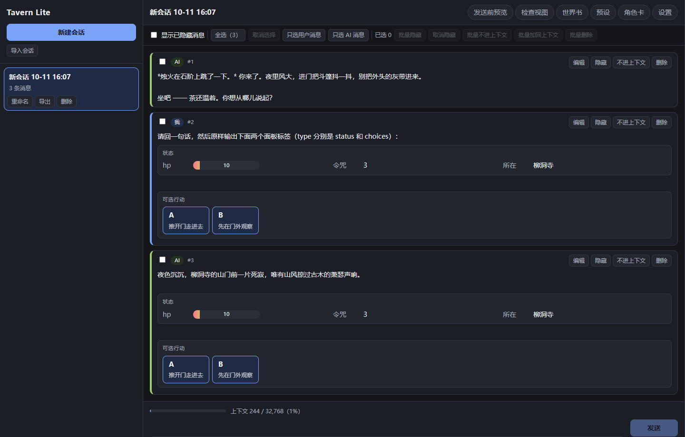
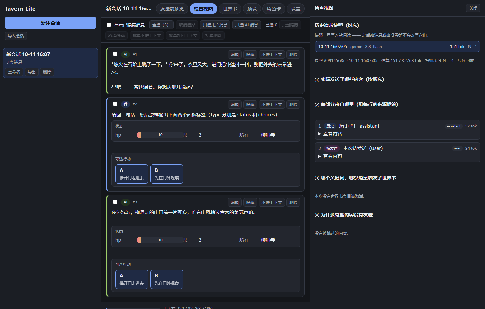

# 我的酒馆 · Tavern Lite

> 一个**纯前端、本地优先**的轻量 SillyTavern：自己做角色卡、自己写世界书、自己决定每次请求到底发了什么 —— 数据全部落在浏览器 IndexedDB，没有后端。

React 18 + TypeScript + Vite，**运行时依赖只有 `react` / `react-dom`**。




---

## 1. 启动方式

### 环境要求

| 项 | 要求 | 自检 |
|---|---|---|
| Node | **≥ 20.19 或 ≥ 22.12**（要能跑 Vite 7） | `node -v` |
| 浏览器 | Chrome / Edge 等 Chromium 系（用到 `structuredClone`、`crypto.randomUUID`、IndexedDB） | — |

```bash
node -v          # 先确认版本；低于 20.19 或 22.12 之前的版本请先升级
```

### 正常路径（两条命令）

```bash
npm ci           # 有 package-lock.json 时优先用 ci；没有锁文件才退回 npm install
npm run dev      # 打开 http://localhost:5173
```

> 说明：Node **≥ 20.19 / ≥ 22.12** 是 Vite 7 的硬要求。本题的 devDeps 只允许 `vite` / `@vitejs/plugin-react` / `typescript` / `@types/*`，不引任何测试框架、状态库或 IndexedDB 封装（见 §7）。

### 配置模型服务

复制 `.env.example` 为 `.env.local`，填三行：

```ini
LLM_BASE_URL=https://你的服务地址/v1
LLM_MODEL=模型名
LLM_API_KEY=你的key
```

也可以在**页面里的「设置 → 模型设置」**里填 `baseUrl` / `model` / `apiKey`（题面要求可配置服务地址、模型名、API Key），界面里填的优先、且**立即生效不用重启**。

### 🔴 安装期无网兜底 / 打开 `dist/` 的能力边界

如果装不上依赖（无网 / 私源不可达），仓库里提交了构建产物 `dist/`（`.gitignore` 默认排除，交付时用 `git add -f dist/` 入库）。

**静态打开 `dist/` 的边界必须说清：**

- **本地功能全部可用**：会话 / 消息 / 世界书 / 预设 / 角色卡 / 快照都在浏览器里跑，不需要网络。
- **模型请求必然失败**：前端**只**请求同源 `/llm`，而静态文件服务器既没有 `/llm` 代理、也没有 `/llm/defaults`；**本项目没有"直连模式"**（直连会被 CORS 挡掉，见 §6）。
- 所以直接用 `file://` 或 `python -m http.server` 打开 `dist/` **只能看界面、不能聊天**。

**推荐的兜底路径**（零依赖，能真正跑通聊天）：

```bash
npm run build
npm run serve:dist     # = node scripts/static-proxy.mjs，默认 http://localhost:4173
```

`scripts/static-proxy.mjs` 是一个**零依赖**的小服务：静态托管 `dist/` + 转发 `/llm`、`/llm/defaults`，语义与 dev server 的代理完全一致。

> 若在 `npm run preview`（端口 4173）里演示：`vite.config.ts` 把代理同时挂在了 `configureServer` 和 `configurePreviewServer` 上，所以 preview 模式下 `/llm` 与 `/llm/defaults` 都可用。

### 单测跑法

```bash
npm test          # = node --experimental-strip-types --test "tests/*.test.ts"
```

**不引入 `vitest`**：`src/core/` 是纯函数内核、不依赖 DOM，Node 内置 test runner 直接就能跑（依赖上限也要求如此）。当前 **50 个用例全绿**。

---

## 2. 主要设计

### 2.1 数据模型：消息上的「两个开关 + 一次真删除」

题面要求"隐藏 / 不进上下文 / 删除"是**三个不同的东西**，所以数据层就是三种不同的事实：

| 操作 | 字段 | 影响渲染 | 影响发给 AI | 数据还在吗 |
|---|---|---|---|---|
| **界面隐藏** | `uiHidden: true` | ✅ 折叠 / 半透明 | ❌ **一个字都不少** | 在 |
| **不进上下文** | `excluded: true` | ❌ 正常显示 | ✅ 从上下文和扫描集里剔除 | 在，随时可加回 |
| **删除** | 记录**从 store 里真的删掉** | 消失 | 消失 | **不在** |

🔴 **删除不是第三个标志位**：`uiHidden` / `excluded` 是消息上的两个布尔字段，而删除是**真的把记录从库里抹掉** —— 调用链是
`store.removeMessages(ids)` → `repo.deleteMessages(ids)` → `idbDeleteMany('messages', ids)`
（`src/state/store.tsx` → `src/storage/repo.ts` → `src/storage/idb.ts`）。它们不是同一个开关的三种叫法。

其他关键字段：

- `status: 'complete' | 'streaming' | 'interrupted'` —— 未完成的助手回复**不进上下文、也不进扫描集**；刷新打断的流式消息修成 `interrupted`，不会永远卡在 `streaming`。
- `seq` —— 会话内单调递增，用于稳定排序 + "重试不重复插入同一条 user 消息"。
- `requestId` —— 助手消息指回生成它的那条 `RequestSnapshot`。

### 2.2 上下文装配顺序与为什么这么定

`buildRequest()`（`src/core/assembly.ts`，纯函数）固定六步：

```
① character          角色卡描述（persona）
② preset-system      预设里 position='system' 的模块（按 order 排序，展开 {{}}）
③ worldbook          本次激活的世界书条目（每条一行，常驻在前、命中在后）
④ history            合格历史（excluded=false 且 status='complete'，按 seq）
⑤ pending            本次待发送的那条 user 消息
⑥ post-history       预设里 position='postHistory' 的模块
```

**为什么这么定：**

- **角色卡最前**：它是"这个人是谁"的底色，必须在所有指令之前。
- **世界书插在系统提示之后、历史之前**：世界书是"补充设定"，属于背景信息，放在对话历史之前才符合"先设定、后对话"的阅读顺序（这是本项目自定的位置，题面只说"处理顺序"）。
- **pending 单独成部分**：装配时用 `seq === pendingSeq` **排除**那条已经入库的 user 消息，否则它会在 `history` 和 `pending` 里**各出现一次**（PLAN §8 用例 16）。
- **post-history 放最后**：用于"事后指令 / 输出格式约束"这类需要压在对话末尾的模块。

### 2.3 🔴 世界书引擎：题面五条规则

`activateWorldBook()`（`src/core/worldbook.ts`，纯函数）逐一落实题面规则，**和真实 SillyTavern 有三处刻意的不同**：

| # | 规则 | 实现要点 |
|---|---|---|
| 1 | **只在单条消息正文内匹配，不跨消息拼接** | `matchKeyword` 是"外层遍历消息、内层遍历关键词"——每条消息独立判断，绝不把多条消息拼成一个大字符串再 `includes`。这是**与真实 SillyTavern 的第一处不同**。 |
| 2 | **不递归** | 激活的世界书**正文不再被扫描**；角色卡描述 / persona **也不参与匹配**。这是**第二处不同**。 |
| 3 | **启用 +（常驻 或 关键词命中）才算候选** | `enabled === false` 的条目**一律不激活**（禁用优先，即使关键词命中）；无关键词的非常驻条目**不参与**（视为永远未命中）。 |
| 4 | **排序 = `priority` 降序，同级按 `id` 的 ASCII 升序** | 直接字符串比较即可：`"10" < "9"`（`'1'`=49 < `'9'`=57），**不是数值序**。这是**第三处不同**（SillyTavern 的 tie-break 不同）。 |
| 5 | **同一条目最多插入一次** | 按 `entry.id` 去重；被丢弃者记入 `skipped{ reason: 'duplicate_id' }`，**不静默丢条目**。 |

**扫描集**：`scanDepth = N` 表示**最近 N 条合格历史**（`excluded === false && status === 'complete'`）**另加**本次待发送消息 ⇒ 一共 `N+1` 条参与匹配。被 `scanDepth` 截断在外的合格历史，逐条产出 `skipped{ reason: 'out_of_scan_depth', source: 'message' }`。

> ⚠️ 我们**不采用**"pending 计入 N 之内"的读法 —— 那会让"最近 N 条"实际只扫到 N−1 条历史，与题面例子（"扫描深度 3，关键词只在第 4 条旧消息里 ⇒ 不激活"）对不上。

**每一处"没发"都要有原因**：`skipped` 表用判别字段 `source: 'entry' | 'message'` 区分"条目级未发送"与"消息级未发送"，靠 `reason` 细分（`disabled` / `no_keyword_match` / `empty_content` / `budget_exceeded` / `out_of_scan_depth` / `message_excluded` / `message_incomplete` / `duplicate_id`）。检查视图里逐条列出、可点击跳到该条目。

**每条"发了"都要有证据**：`activations` 记录 `{ entryId, entryName, reason: 'constant' | 'keyword', matchedKey?, matchedMessageId? }` —— 能回答"**哪个关键词、在哪条消息里**命中了它"。

### 2.4 🔴 预算机制是「本项目自行引入」的（必须主动交代）

题面规则 5 只规定了"**按优先级处理** + 同一条目最多插入一次"，**没有提"预算"或"丢弃"**；"预算"一词在整个题面里**只出现在等级 4**。

本项目的做法是：

- 预算 = `budgetTokens = floor(contextLimit × worldBookBudgetPct / 100)`，默认 `contextLimit = 32768`、`worldBookBudgetPct = 25`。
- 按 `priority` 降序**逐个尝试**：`used + t > budgetTokens` ⇒ 记 `skip('budget_exceeded')` 并 **`continue`**（跳过装不下的、继续尝试后面的小条目，**不是 `break`**）。**先处理的先占预算** —— 这正是"处理顺序"有意义的地方。
- **绝不静默截断**：`worldbook` 部分末尾追加一行"（世界书预算已满，共 N 条未插入）"，同时逐条列进"未发送原因"。

**这个机制的动机**：给题面的"上下文过长提醒"一个**可解释的配额**。
**怎么关掉它**：把 `worldBookBudgetPct` 调成 **100** 即等价于关闭（此时除非整段世界书就超过整个上下文上限，否则不会因预算丢弃）。

### 2.5 快照机制：已发送的请求不可被后续编辑改写

每次发送前，`buildRequest()` 的结果被 `freezeSnapshot()` **深拷贝冻结**成一条 `RequestSnapshot`：

- `parts`（每部分的 `kind` / 来源 / 正文 / tokens）——**冻结当时的原文**；
- `activations`（命中证据）+ `skipped`（未发送原因）；
- `totalTokens` / `contextLimit` / `scanDepth`。

**冻结之后**：改历史消息、改设置、改世界书，都**只影响下一次**"发送前预览"，**已发出的快照一个字都不变**。快照落库，刷新后仍能从"检查视图"里回放 —— `partsToChat()` 用 `parts` 里带的 `role` 把冻结内容还原成当时真正发给模型的消息数组。

**为什么**：题面要求"保存发送后的请求快照"并能查看。如果快照是"引用当前状态再实时计算"，那它就不是快照、而是又一次预览 —— 改一条历史消息就会让"当时到底发了什么"这个事实消失。

> 🔴 **阈值判定也以快照为准**：`contextWarnPct`（默认 80%）的判据是 `RequestSnapshot.totalTokens / contextLimit`，**不是**预览里实时算出来的百分比。流式生成期间改输入框或改设置，**不得**重算本次快照。预览时显示的百分比**仅供参考**。

---

## 3. 兼容范围声明

### 3.1 预设格式 schema（本项目自定义 `st-lite` v1.0）

```jsonc
{
  "format": "st-lite",
  "formatVersion": "1.0",
  "name": "示例预设",
  "modules": [
    {
      "id": "m1",                 // 必填，唯一
      "name": "写作风格",          // 必填
      "role": "system",           // system | user | assistant
      "content": "请用简洁的...",  // 可含 {{变量}}
      "enabled": true,            // false = 不参与编排
      "order": 10,                // 升序
      "position": "system",       // system | postHistory
      "template": false           // true 时展开 {{}}
    }
  ],
  "contextConfig": {              // ⚠️ 仅作【会话初值】
    "contextLimit": 32768,
    "scanDepth": 4,
    "worldBookBudgetPct": 25,
    "contextWarnPct": 80
  }
}
```

- **数据驱动**：模块**不写死名字**，靠 `position` + `order` 参与编排（增删模块不需要改代码）。
- **`{{}}` 模板**：支持 `{{var}}` 与单层 `{{#if var < N}}...{{/if}}`；**缺失变量保留原样**并在结果里报告（不静默替换成空串）。
- 🔴 **`contextConfig` 只是初值**：预设只在会话**首次绑定**时写入 `SessionSettings`，之后**以会话设置为准**（同名冲突一律会话优先）。

### 3.2 Character Card V2 支持的子集 + 被忽略的运行规则

**导入**（JSON；PNG 的 `tEXt` 块 `chara` / `ccv3` 也会尝试提取）：

- 支持 `spec: "chara_card_v2"`、`spec_version = "2.*"`；`spec_version = "1.0"` ⇒ **拒绝**并说明支持范围。
- 字段映射（`FIELD_MAPPING`）：

| V2 字段 | 本项目 | 说明 |
|---|---|---|
| `data.name` | `name` | |
| `data.description` | `description` | |
| `data.first_mes`（也接受 `first_message`） | `firstMes` | 开场白 |
| `data.character_book` | 转成一份世界书 | 逐条映射；缺 `name` 的条目退化为注释 |
| 其他字段 / 未知 `extensions` | **原样保留在 `raw`** | 导出时**原样写回**，不丢 |

- 🔴 **被忽略的运行规则**（`IGNORED_RULES`，**共 14 项**，**只搬运设定文本、不执行运行期行为**）——
  这些是 V2 卡内嵌世界书条目（`data.character_book.entries[]`）上携带的 SillyTavern 专有运行配置，
  导入时**照收字段但不执行**，导出时**原样写回**：

  `secondary_keys` · `selective` · `selectiveLogic` · `position` · `case_sensitive` ·
  `match_whole_words` · `probability` · `sticky` · `cooldown` · `delay` ·
  `group` · `group_weight` · `scan_depth` · `vectorized`

  > 其中最容易踩的一条：**V2 卡自带的 `scan_depth` 不生效** —— 扫描深度一律以本会话的设置
  > （`SessionSettings.scanDepth`）为准，不被卡里的值覆盖。
  > 导入预览页会把"**这张卡里实际出现了哪几条**被忽略的规则"逐条列出来（`CardImportOk.ignoredPresent`），
  > 而不是把 14 项全念一遍。

  简言之：**本项目的世界书引擎是自己那套五条规则**，不执行 V2 卡里带的 ST 专有扫描配置。

**导出**：把 `raw` 原样写回 + 用当前 `name` / `description` / `firstMes` 覆盖对应字段 + 可选把一份世界书写进 `character_book`。

- **PNG**：`tEXt` 提取是**扩展能力**（尽力而为）；导出**不生成 PNG**（只导 JSON）。

---

## 4. 设计决策 / 已知取舍（默认值账本）

| 项 | 取值 | 备注 |
|---|---|---|
| 世界书扫描深度 `scanDepth` | **4**（范围 1–100） | `N` = 最近 N 条合格历史 **+ 本次待发送**（共 N+1 条）。`0` / 负数 = 非法 ⇒ **钳制为 1**；`> 100` ⇒ 100 |
| 上下文上限 `contextLimit` | **32768** | 可配置 |
| 世界书预算 `worldBookBudgetPct` | **25** | **本项目自定**（见 §2.4）；调 100 = 关闭 |
| 提醒阈值 `contextWarnPct` | **80** | 题面示例值；**以发送瞬间的快照为准**（见 §2.5） |
| 关键词匹配 | **大小写不敏感**子串包含 | `key` 先 `trim()`；空 key 无效跳过；**不做正则 / 分词 / 整词匹配** |
| 排序 / 去重 | `priority` 降序，同级 `id` **ASCII 升序**；按 `entry.id` 去重 | 见 §2.3 |
| 世界书插入位置 | 拼成一个 `worldbook` 部分，插在**系统提示之后、历史之前**，每条一行 | 自定 |
| token 估算 | CJK 按 1、其他按每 4 字符 1 token **粗估** | 🔴 **这是估算**，不是任何模型的真实分词器（见 §8） |
| 用户消息落库时机 | 入库即 `status='complete'` 并分配 `seq` | 装配时按 `seq === pendingSeq` 排除同一条 |
| 流式写库节流 | **≥ 500ms 或累计 200 字符**写一次 | 刷新后据此恢复或标记 `interrupted` |
| 导出格式 | 单个 `.json`：`{ format, formatVersion, session, messages, snapshots, characterCard?, worldBooks? }` | 文件名带会话标题与时间 |
| 导入同 ID 冲突 | **必须三选一：覆盖 / 创建副本 / 取消** | 副本 = **分配新 ID，绝不复用原 ID**，标题加 `（副本 2）`；固定三步：先建副本资源 → 一张 `idMap` 一次性重写所有引用 → 最后替换原资源 |
| 删除级联 | 删会话 → 级联删其 `messages` / `snapshots` | 删预设 → 已导入会话保留快照出的模块副本；删世界书 → 从各会话引用中移除，不留悬空 |
| 同名 | 允许重名，靠 ID 区分 | |

---

## 5. 未实现（如实声明）

以下**明确没做**，不要以为有：

- ❌ **世界书递归扫描**（激活条目的正文不再被扫描）、**次级关键词（secondary keys）**、
  **概率触发**、**sticky / cooldown 定时效果**、**分组互斥**、**向量检索 / 语义召回** ——
  题面明确说"核心版本不递归"，这些都是真实 SillyTavern 的复杂度，刻意不搬。
- ❌ **不扫描角色卡描述 / persona**（与"不递归"同口径）。
- ❌ **总结扩展**（**没有**"生成摘要 → 使用 → 撤销"这套）—— 未选此项。
- ❌ **移动端适配**（窄屏能用但未做专门适配）。
- ❌ **PNG 角色卡导出**（只支持 JSON 导出；PNG 仅支持**导入**时尽力提取）。
- ❌ **多模态 / 附件上传**、**多角色群聊**、**正则脚本执行**（V2 卡里的 `regex_scripts` 只保留不执行）。
- ❌ **后端 / 多用户**（纯前端，数据只在当前浏览器）。

---

## 6. CORS 与 `/llm` 代理（为什么必须走代理）

🔴 **浏览器直连第三方 LLM API 会被 CORS 拦掉** —— 这类 API 通常不返回允许浏览器跨域调用的 CORS 头。所以本项目：

- **`/llm` 是唯一**的模型请求路径，前端**不直连**任何第三方地址。
- 代理（`vite.config.ts` 里的 `/llm` 中间件，`scripts/static-proxy.mjs` 同逻辑）只做**三件事**：
  1. `GET /llm/defaults` → 返回 `.env` 里的 `{ baseUrl, model }`（**绝不返回 key**），用于启动时预填设置面板；
  2. 其余 `/llm/*` → 按请求头 `x-llm-base-url`（合法 `http(s)://` 才认）**动态选目标**；没有该头就回落 `.env` 的 `LLM_BASE_URL`；
  3. 在 **Node 侧**注入 `Authorization: Bearer <x-llm-api-key || .env 的 LLM_API_KEY>`。
- **代理不改写请求体**（`model` 由前端**始终显式发送**），**不缓冲响应**（逐块透传，否则流式 SSE 会变成"等整段返回后一次性出现"；响应头带 `x-accel-buffering: no`）。

**为什么不用 `server.proxy`**：Vite 7 的 `ProxyOptions` **没有 `router` 选项**（那是 http-proxy-middleware 的），且 `target` 类型是 `string`、**不接受函数** —— 也就是说它**做不到"按请求头动态选 target"**。而题面要求"面板里填的 baseUrl 立即生效"，所以改成自写中间件，语义与规格一致。详见 `docs/notes-plan-conflicts.md` §4。

---

## 7. 密钥与环境变量

🔴 **仓库内任何文件都不得写真实 key。**

- 真实 key **只存在 `.env.local`**，且 `.env.local` 已被 `.gitignore` 排除。
- 🔴 **变量名刻意不加 `VITE_` 前缀**：`VITE_*` 会被 Vite **编译期内联进客户端 bundle** —— 只要有人写一句 `import.meta.env.VITE_LLM_API_KEY`，key 就进了前端产物。这里用 **`LLM_`** 前缀，`vite.config.ts` 用 `loadEnv(mode, root, 'LLM_')` 在 **Node 侧**读取，**浏览器侧代码永远看不到这些变量名**。
- 浏览器侧「模型设置」面板可配 `baseUrl` / `model` / `apiKey`（题面要求），存在 `settings` store（IndexedDB）。
- 🔴 **事实与风险（必须知道）**：**用户在面板里填的 key 会落在浏览器本地（IndexedDB）**，清浏览器数据即失效；**共享 / 公用机器上不要填私人 key**。
- `.env` 里的 `LLM_*` 只是**默认值**，**改它需要重启 dev server**；在面板里改 `baseUrl` **不需要**（代理按请求头动态路由）。
- **三项都留空** ⇒ 全用 `.env` 默认值（此时浏览器不持有 key）。
- `docs/problem-statement.md` 里的 key 已掩码；该文件按交付要求保留（它是题面依据）。
- 🔴 **首个 commit 前确认 `git status` 里没有密钥文件**（`.env.local`、`*.local` 均已在 `.gitignore` 中）。

---

## 8. token 估算与 80% 提醒（口径说明）

- **估算方式**：CJK 字符按 1 token、其他字符按每 4 字符 1 token **粗估**（`ceil(cjk + other/4)`）。
  🔴 **这是估算，不是任何模型的真实分词器** —— 只用于给出量级感与触发提醒，不保证与模型账单一致。
- **世界书预算**：`floor(contextLimit × worldBookBudgetPct / 100)`（见 §2.4）。
- **提醒判定**：装配后 `totalTokens / contextLimit >= contextWarnPct / 100` ⇒ 显示提醒条。
  提醒条**带"可处理的消息入口"**（点击打开批量面板，可批量 `excluded` 旧消息），
  且在**发送前预览**区域同样出现。
- 🔴 **判定以发送瞬间冻结的快照为准**（见 §2.5），预览时显示的百分比仅供参考。

---

## 9. 演示步骤（约 5 分钟）

> 样例数据都在 `samples/`：`sample-session.json`（含 8 条消息、1 条快照、角色卡与世界书）、
> `sample-character-v2.json`、`sample-preset.json`、`sample-message-with-panels.md`。

1. **开门营业**：新建会话 →（内置默认角色卡 `DEFAULT_CHARACTER`）**开门即见开场白** →
   发一条消息 → 回复**逐段流式增长**。
   > 验证流式真的在流：DevTools → Network → `/llm` 的响应是**多个 chunk 增量到达**、聊天气泡**一段段长**，
   > 而不是等整段返回后一次性出现。
2. **刷新**：按 F5 → 会话 / 消息 / 状态都还在（IndexedDB）。
3. **消息控制**：隐藏一条（界面变化，但**"发送前预览"里它仍在**）→ 再"不进上下文"另一条（预览里**消失**）
   → 指出两种标记**视觉可区分**。
4. **世界书**：新建条目（关键词命中 → 自动激活）→ 加一条**常驻** → 把一条**禁用** →
   打开「检查视图」，指出：**哪条命中、哪个关键词、哪条消息触发**，以及**哪条为什么没发送**。
5. **上下文提醒**：把 `contextLimit` 调小（如 1000）→ 提醒条出现 → 点消息入口批量排除旧消息。
6. **tavern-panel**：发一条含示例标签的消息（可直接从 `samples/sample-message-with-panels.md` 复制）
   → 看到正文 + 状态栏 + 按钮 → **点按钮 → 文字进输入框（不自动发）**。
7. **错误兜底**：故意贴一个坏 JSON 的标签 → **显示原文 + 具体问题**（不丢内容）。
8. **导入 / 导出**：「导入会话」选 `samples/sample-session.json` → 若 ID 已存在则出现**覆盖 / 创建副本 / 取消**三选一；
   导出后文件名带标题与时间。

> 演示前建议把 `docs/defense/README.md` 的"30 秒版四句话"和"三个陷阱题"先背一遍。

---

## 10. 目录结构

```
problem4-tavern/
├─ src/
│  ├─ core/              # 🔴 纯函数内核：不依赖 DOM / React，可被 node --test 直接跑
│  │  ├─ types.ts              # 全应用数据契约
│  │  ├─ worldbook.ts          # 世界书引擎（题面五条规则）
│  │  ├─ assembly.ts           # buildRequest / partsToChat / freezeSnapshot
│  │  ├─ panel.ts              # <tavern-panel> 解析（坏标签保留原文）
│  │  ├─ characterCard.ts      # V2 导入 / 导出
│  │  ├─ preset.ts             # 预设格式 st-lite 校验 / 序列化
│  │  ├─ template.ts           # {{}} 模板展开
│  │  ├─ tokens.ts             # token 估算 / 预算 / 阈值
│  │  ├─ llm.ts                # /llm 客户端（SSE）
│  │  └─ defaultCharacter.ts   # 内置默认角色卡
│  ├─ storage/           # IndexedDB 薄封装 + 仓储（级联删除 / 导入 idMap）
│  ├─ state/             # useReducer + Context（流式生成 / 快照冻结）
│  ├─ ui/                # 组件（仅渲染与交互，业务逻辑都在 core/）
│  ├─ App.tsx, main.tsx, styles.css
│  └─ ...
├─ tests/                # 50 个用例（Node 内置 test runner）
├─ samples/              # 可演示的样例数据
├─ docs/
│  ├─ problem-statement.md     # 题面原文（key 已掩码）
│  ├─ notes-plan-conflicts.md  # 实现期与 PLAN 的偏离记录
│  ├─ screenshots/             # 截图
│  └─ defense/                 # 🔴《答辩问答》每个模块一份
├─ scripts/static-proxy.mjs    # 零依赖兜底服务（静态 + /llm 转发）
├─ vite.config.ts              # /llm 转发中间件（dev + preview）
└─ README.md
```

**🔴 每个模块的《答辩问答》在 [`docs/defense/`](docs/defense/README.md)** —— 覆盖世界书引擎、上下文装配、消息三分离、快照与检查视图、panel 解析、预设、角色卡 V2、存储、状态与流式、`/llm` 代理、token 与用量，共 11 份，每份含"**① 这段在干什么 ② 关键设计决策 + 为什么 ③ 会被追问的问题与要点**"。
